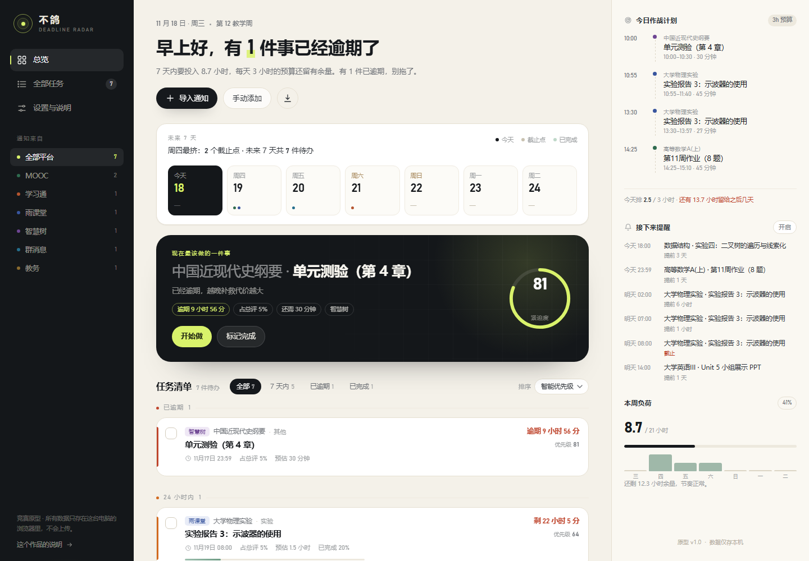

# 不鸽 · Deadline Radar

> 把散落在 MOOC、学习通、雨课堂、班级群里的作业截止时间，收进一张今晚就能执行的作战地图。

赛题一「AI 辅助开发 · 创意产品原型」参赛作品。
纯前端网页原型，零后端、零依赖、零网络请求，双击 `index.html` 即可运行。



---

## 它解决什么

作业分散在多个教学平台、班级群和教务系统里，每个平台只提醒自己的事。学生要人肉完成
「读通知 → 判断截止 → 抄进备忘录 → 估算时间 → 决定先做哪个」这一整条链路，结果常常是
最后一晚才发现要交三样。

不鸽不重造待办清单，只补上最费力的一步：**把一段非结构化通知，变成结构化的截止时间和今晚的时间表。**

```
粘贴通知 → 结构化识别 → 人工确认 → 优先级排序 → 今日时间块 → 完成 / 导出 .ics
```

## 快速开始

方式一：双击 `buge/index.html`，用 Chrome / Edge 打开。无需安装、无需联网。

方式二：

```bash
cd buge
python -m http.server 8000
# 浏览器打开 http://localhost:8000
```

演示入口（地址后加参数，可直接跳到某个状态）：

| 参数 | 效果 |
| --- | --- |
| `?state=import` | 打开导入弹层并填入示例通知，自动识别 |
| `?state=manual` | 打开发手动添加表单 |
| `?state=tasks` | 直接进入全部任务视图 |
| `?state=settings` | 打开设置与作品说明 |
| `?state=empty` | 清空数据，查看空状态 |

> 想给评委一个在线地址：仓库 **Settings → Pages → Source 选 `main` / `root`**，
> 之后访问 `https://<你的用户名>.github.io/<仓库名>/buge/` 即可。

## 功能

- **通知解析**：粘贴多段通知自动分条，识别课程、任务、截止时间、来源平台、成绩占比、预计工时；每个字段带置信度。
- **统一看板**：未来 7 天雷达、按紧急度分组的清单、实时倒计时。
- **可解释排序**：紧迫度 × 成绩权重 × 时间风险三项加权，界面直接给出「为什么先做它」。
- **今日作战计划**：按预算把剩余工时切进 45 分钟时间块，避开午饭/晚饭，超出预算明确提示。
- **提醒**：每个截止自动生成 4 个提醒节点；页面开着时可弹桌面通知。
- **日历导出**：生成含 `VALARM` 的 `.ics`，可导入手机自带日历。
- **本地持久化**：`localStorage`，刷新不丢；可一键恢复示例或清空。

### 优先级公式

```
优先级   = 52% × 紧迫度 + 26% × 成绩权重 + 22% × 时间风险
紧迫度   = e^(−剩余小时 / 60)            // 逾期记 1
成绩权重 = min(占比 / 30, 1)
时间风险 = min(剩余工时 / 剩余小时, 1.5) / 1.5
最终得分 = round(100 × √原始分)
```

### 排程规则

45 分钟一块、块间 10 分钟；12:00–13:30 与 18:00–19:00 不排，单块在饭点前截断；
不足 12 分钟则整体挪到饭后；当日预算默认 3 小时（可调 1–8 小时）。

## 仓库结构

```
.
├── buge/                 可运行原型
│   ├── index.html        页面骨架
│   ├── assets/           styles / data / parser / store / ui
│   ├── tests/            解析器单测 + 端到端测试
│   └── shots/            界面截图
└── docs/                 提交材料
    ├── 不鸽-Deadline-Radar-参赛文档.docx   项目文档（20 页）
    ├── 不鸽-Deadline-Radar-项目方案.pptx   项目方案（19 页）
    ├── 演示视频脚本-5分钟.md                5 分钟分镜与解说词
    └── flow.png                            核心闭环示意图
```

## 测试

```bash
# 解析器：纯 Node，无需依赖
node buge/tests/parser.test.js
# 27 / 27 通过

# 端到端：用无头 Edge 打开页面并模拟点击
node buge/tests/e2e.mjs
# 26 / 26 通过
```

端到端覆盖：首屏渲染、导入弹层、示例识别、逐字段校验、去重、勾选完成、编辑表单、
刷新持久化、每日预算设置、`.ics` 生成、未捕获异常。

## 提交材料

| 材料 | 文件 | 说明 |
| --- | --- | --- |
| 项目文档（Word） | [参赛文档](docs/不鸽-Deadline-Radar-参赛文档.docx) | 背景 / 方案 / 技术路径 / 团队分工 / 创新点与价值 / 总结与展望；附录含 AI 使用、关键 Prompt、开发过程、迭代、测试与人工核查 |
| 项目方案（PPT） | [项目方案](docs/不鸽-Deadline-Radar-项目方案.pptx) | 19 页 / 16:9 |
| 演示视频脚本 | [5 分钟脚本](docs/演示视频脚本-5分钟.md) | 分镜、解说词与录制参数 |

## 数据与隐私

- 所有示例任务均为虚构，截止时间相对「打开页面的时刻」动态生成，任何日期演示都成立。
- 平台名称仅作为识别词典示例，不接入任何平台账号，不爬取、不上传。
- 用户粘贴的文本只在本机解析；数据存在浏览器 `localStorage`（键 `buge.deadline.v1`）。

## 已知限制

- 规则解析覆盖有限：长句、口语化、没有明确截止时间的通知识别较弱。
- 没有平台官方接口，仍需复制粘贴。
- 桌面提醒要求页面处于打开状态。
- 单机存储，不跨设备同步（用 `.ics` 导出弥补）。

## AIGC 说明

本作品的选题、需求判断、规则边界、功能取舍、验收标准与最终修改由参赛者完成；
前端代码、解析规则初稿、文案初稿、测试脚本与文档排版由 AI 编程助手（DeepSeek）生成，
并经逐项审查、修改与实测。详见项目文档中的 AIGC 使用声明与附录 A。
