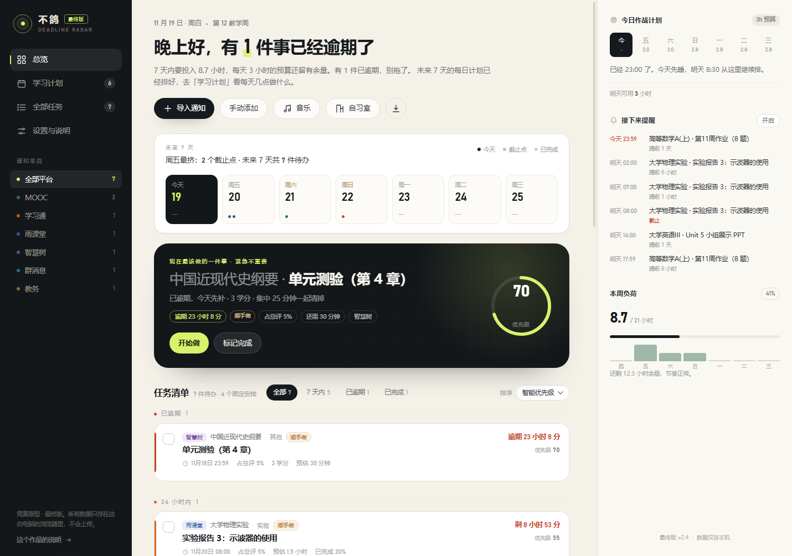
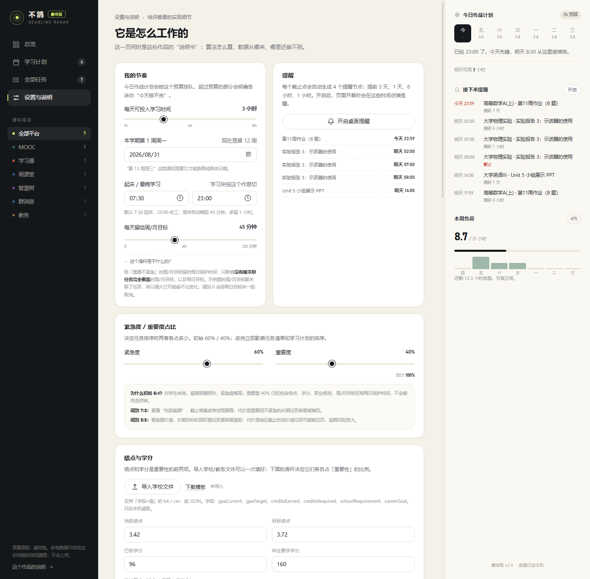
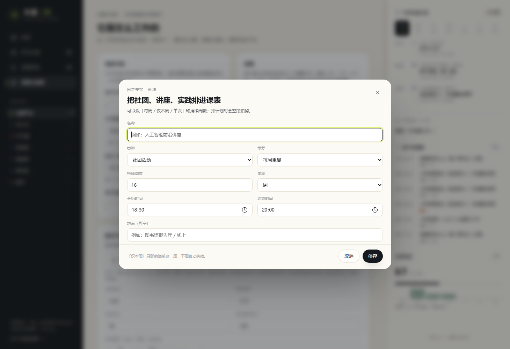
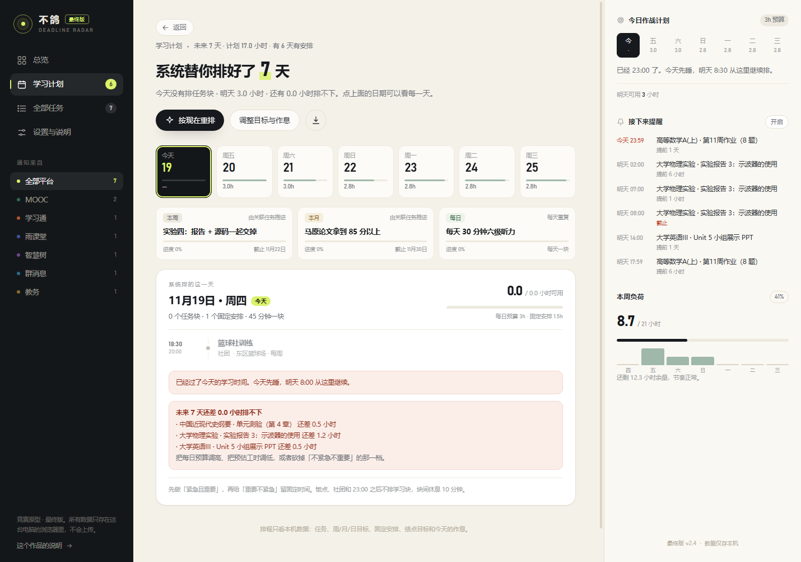
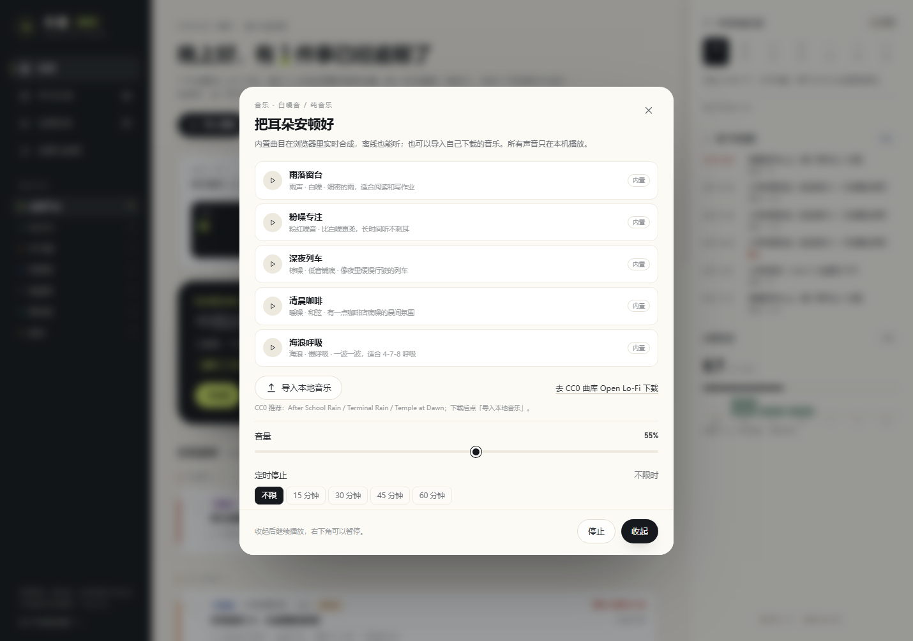

# 不鸽 · Deadline Radar · 最终版

> 把散落在 MOOC、学习通、雨课堂、班级群里的作业截止时间，连同周/月/日目标、绩点、学分、职业规划和固定安排，排成未来 7 天每天都能照着做的时间表。

赛题一「AI 辅助开发 · 创意产品原型」参赛作品 · **最终版**（在四版基础上继续迭代）。
纯前端网页原型，零后端、零 API Key、零网络请求，双击 `index.html` 即可运行。

> 最终版新增：设置里可以滑动调整「紧急度 / 重要度」占比，初始 60:40，可调到 7:3 或 5:5，立即影响任务排序；
> 卡片下方给出 6:4、7:3、5:5 的简短说明。四版的音乐改名、目标时间滑杆解释、三版的占比/职业规划/档案导入全部保留。
> 具体改动见 [最终版修改说明](docs/修改说明-最终版.md)；`docs/` 内旧版材料未改动。







---

## 它解决什么

作业分散在多个教学平台、班级群和教务系统里，每个平台只提醒自己的事。学生要人肉完成
「读通知 → 判断截止 → 抄进备忘录 → 估算时间 → 决定先做哪个」这一整条链路，结果常常是
最后一晚才发现要交三样。

不鸽不重造待办清单，只补上最费力的一步：**把一段非结构化通知，变成结构化的截止时间和今晚的时间表。**

```
粘贴通知 → 结构化识别 → 人工确认 → 紧急 × 重要排序 → 目标 / 社团 / 绩点进排程 → 未来 7 天时间块 → 完成 / 导出 .ics
```

## 快速开始

方式一：双击 `buge/index.html`，用 Chrome / Edge 打开。无需安装、无需联网。

方式二：

```bash
cd buge
python -m http.server 8000
# 浏览器打开 http://localhost:8000
```

演示入口（地址后加参数，可直接跳到某个状态）：

| 参数 | 效果 |
| --- | --- |
| `?state=import` | 打开导入弹层并填入示例通知，自动识别 |
| `?state=manual` | 打开发手动添加表单 |
| `?state=plan` | 直接进入未来 7 天学习计划 |
| `?state=tasks` | 直接进入全部任务视图 |
| `?state=settings` | 打开设置与作品说明 |
| `?state=music` | 打开「音乐」白噪音播放器 |
| `?state=study` | 打开「自习室」限时专注 |
| `?state=empty` | 清空数据，查看空状态 |

> 想给评委一个在线地址：仓库 **Settings → Pages → Source 选 `main` / `root`**，
> 之后访问 `https://<你的用户名>.github.io/<仓库名>/buge/` 即可。

## 功能

- **通知解析**：粘贴多段通知自动分条，识别课程、任务、截止时间、来源平台、成绩占比、预计工时；每个字段带置信度。
- **统一看板**：未来 7 天雷达、按紧急度分组的清单、实时倒计时。
- **可解释排序**：紧急度 × 重要度两维打分，落进「紧急且重要 / 重要不紧急 / 紧急不重要 / 不紧急不重要」四象限，界面直接给出「为什么先做它」。
- **紧急 / 重要占比可调（最终版新增）**：设置顶部新增一张卡，两根滑杆分别调紧急度和重要度的总占比，初始 60% / 40%；调到 7:3 或 5:5 会立即影响任务清单和学习计划的排序。卡片下方给出三种比例分别适合什么情况、有什么代价。
- **重要性占比可调（三版新增）**：重要度内部再拆成「绩点 / 课程学分 / 职业规划」三项，默认 30% / 30% / 40%；设置里三根滑杆独立调整，调高一项，另外两项按原比例自动让出，合计始终 100%。
- **职业规划卡（三版新增）**：填写个人生涯/职业规划目标，并调它占重要性的比例；任务表单勾「与职业规划相关」后才拿这一项权重。没填职业规划时这一项不参与，另外两项按比例重分配。
- **学校档案导入（三版新增）**：设置里可导入 txt / csv / json，读入当前绩点、目标绩点、已修学分、毕业要求学分、学校要求、职业规划；文件只在本机读取，不联网、不上传。也可以下载模板再改。
- **固定安排周期（三版新增）**：社团/讲座支持「每周重复 / 仅本周 / 单次」和持续周数（1–52）；已有安排可以编辑持续周数，到期的自动不再进计划。
- **学习计划**：系统排未来 7 天，每天按 45 分钟切块；可逐天查看、勾完成、重新排。
- **固定安排进任务清单**：社团、例会、讲座、课外实践不只在计划页出现，也会列进总览和全部任务的「固定安排」分组，带下次时间。
- **其他活动**：设置里可选「社团活动 / 其他活动」，讲座、实践、家教都能录，排程前整段扣掉。
- **计划页返回键**：学习计划左上角有常规返回图标，误点进来也能退回上一步。
- **音乐（四版由「静室」改名）**：总览页入口，内置 5 段浏览器实时合成的白噪 / 氛围声（雨、粉噪、深夜列车、清晨咖啡、海浪），支持循环、音量和 15–60 分钟定时停止；播放器里还放了 CC0 曲库 [Open Lo-Fi](https://github.com/btahir/open-lofi) 的入口，学生可以下载后导入自己的音乐。
- **自习室**：总览页入口，系统从今天的学习计划里挑出任务（不含社团和其他活动），给出预期时间；学生可以删减任务、改每件事的时长，然后开始不可暂停的倒计时专注，结束时自动结算。
- **周 / 月 / 日目标**：周/月目标每天固定占一段，日目标每天一块；关联任务的进度会自动同步到目标。
- **今日作战计划**：右栏可直接切换看今天或未来 6 天，按预算把剩余工时切进时间块，超出预算明确提示。
- **提醒**：每个截止自动生成 4 个提醒节点；页面开着时可弹桌面通知。
- **日历导出**：生成含 `VALARM` 的 `.ics`，可导入手机自带日历。
- **本地持久化**：`localStorage`，刷新不丢；可一键恢复示例或清空。

### 优先级公式

```
优先级 = round(100 × (紧急占比 × 紧急度 + 重要占比 × 重要度))
默认占比：紧急 60% / 重要 40%；可在设置顶部滑动调整（如 7:3、5:5）。

紧急度 = 60% × 时间余量紧迫 + 40% × 截止临近
  时间余量紧迫 = 剩余工时 ≥ 剩余时间 ? 1 : e^(−(剩余时间 − 剩余工时) / 60)
  截止临近     = 1 / (1 + 剩余小时 / 36)        // 逾期直接记 1

重要度 = 绩点占比 × 绩点因子 + 学分占比 × 学分因子 + 职业占比 × 职业因子
  默认占比：绩点 30% / 课程学分 30% / 职业规划 40%（可滑杆调整）
  绩点因子 = min(占总评% / 40, 1) × (0.7 + 0.3 × 目标绩点差)
  学分因子 = min(课程学分 / 4, 1)
  职业因子 = 任务勾选「与职业规划相关」且职业规划非空 ? 1 : 0
  没填职业规划：职业项不参与，绩点和学分按比例重分配

四象限：紧急度 ≥ 0.55 且重要度 ≥ 0.55 → 马上做；
        重要度高 → 计划做；紧急度高 → 顺手做；其余 → 有空做。
```

### 排程规则

- **先扣固定时间**：12:00–13:30 午饭午休、18:00–19:00 晚饭、23:00 后不排；社团/例会/家调整段扣掉。
- **每块 45 分钟**，块间休息 10 分钟；每天预算默认 3 小时（可调 1–8 小时），周末 +1 小时、晚起 45 分钟。
- **按优先级从高到低排**：截止前按重要度留 0.5–3.5 小时缓冲，长任务往前摊开，短任务尽量连着做完。
- **高难度任务**（论文 / 实验 / 考试 / 展示）优先上午和晚间；碎片任务放到午后低谷，避开刚吃完饭。
- **重要不紧急**：周/月目标每天固定 45 分钟（0–120 可调），日目标每天一块；关联任务完成时目标进度自动同步。
- **排不下不硬塞**：计划页明确写「还差多少小时」，建议调高预算、降低预估，或砍掉「不紧急不重要」那一档。

## 仓库结构

```
.
├── buge/                 可运行原型（最终版）
│   ├── index.html        页面骨架
│   ├── assets/           styles / data / parser / plan / store / profile / audio / ui
│   │   ├── plan.js       学习计划引擎：评分、四象限、7 天排程（纯函数）
│   │   ├── profile.js    学校档案导入：txt / csv / json 解析（纯函数）
│   │   └── audio.js      音乐：Web Audio 白噪合成 + 本地音频导入
│   ├── tests/            解析器 / 排程 / 档案导入单测 + 端到端测试
│   └── shots/            界面截图
└── docs/                 提交材料
    ├── 不鸽-Deadline-Radar-参赛文档.docx   项目文档（20 页）
    ├── 不鸽-Deadline-Radar-项目方案.pptx   项目方案（19 页）
    ├── 演示视频脚本-5分钟.md                5 分钟分镜与解说词
    └── flow.png                            核心闭环示意图
```

## 测试

```bash
# 解析器 / 排程 / 档案导入：纯 Node，无需依赖
node buge/tests/parser.test.js   # 27 / 27 通过
node buge/tests/plan.test.js     # 180 / 180 通过
node buge/tests/profile.test.js  # 24 / 24 通过

# 端到端：用无头 Edge 打开页面并模拟点击
node buge/tests/e2e.mjs          # 83 / 83 通过
```

端到端覆盖：首屏渲染、导入弹层、示例识别、逐字段校验、去重、勾选完成、编辑表单、
刷新持久化、每日预算设置、`.ics` 生成、学习计划逐天切换、目标/社团/其他活动新增、
固定安排进任务清单、计划页返回键、音乐播放器与定时、自习室建议/改时长/倒计时/结算、
重要性滑杆联动、职业规划录入、固定安排持续时间编辑、学校档案导入、
紧急/重要占比 6:4、7:3、5:5 滑动与说明、未捕获异常。

## 提交材料

| 材料 | 文件 | 说明 |
| --- | --- | --- |
| 项目文档（Word） | [参赛文档](docs/不鸽-Deadline-Radar-参赛文档.docx) | 背景 / 方案 / 技术路径 / 团队分工 / 创新点与价值 / 总结与展望；附录含 AI 使用、关键 Prompt、开发过程、迭代、测试与人工核查 |
| 项目方案（PPT） | [项目方案](docs/不鸽-Deadline-Radar-项目方案.pptx) | 19 页 / 16:9 |
| 二版修改说明 | [修改说明](docs/修改说明-二版.md) | 固定安排 / 其他活动 / 返回键 / 静室（四版改名音乐） / 自习室 |
| 三版修改说明 | [修改说明](docs/修改说明-三版.md) | 重要性占比 / 职业规划 / 活动周期 / 学校档案导入 |
| 四版修改说明 | [修改说明](docs/修改说明-四版.md) | 音乐改名 / 目标滑杆暂保留 |
| 最终版修改说明 | [修改说明](docs/修改说明-最终版.md) | 紧急/重要占比可调 / 6:4 说明 / 最终版 |
| 演示视频脚本 | [5 分钟脚本](docs/演示视频脚本-5分钟.md) | 分镜、解说词与录制参数 |

## 数据与隐私

- 所有示例任务、目标、社团与其他活动均为虚构，截止时间相对「打开页面的时刻」动态生成，任何日期演示都成立。
- 平台名称仅作为识别词典示例，不接入任何平台账号，不爬取、不上传。
- 用户粘贴的文本只在本机解析；任务、目标、固定安排、绩点、学分、职业规划和作息都存在浏览器 `localStorage`（键 `buge.deadline.v1`）。
- 音乐内置声音由浏览器 Web Audio 实时合成，不联网；导入的本地音乐只在页面内存里播放，不上传、不写入磁盘。
- 学校档案文件只由 `FileReader` 在本机读取，解析后写入设置，不上传、不联网。

## 已知限制

- 规则解析覆盖有限：长句、口语化、没有明确截止时间的通知识别较弱。
- 没有平台官方接口，仍需复制粘贴；没有接入学校课表，固定安排需要手动录入。
- 绩点只做「占总评 × 目标差」的粗略衡量，不精确换算每门课的绩点公式。
- 职业规划对任务的影响由任务表单里「与职业规划相关」手动勾选，不做语义匹配。
- 学校档案只支持「字段=值」的 txt / csv 或 JSON；不同学校的原始成绩单格式需要先按模板整理。
- 音乐内置是合成白噪 / 氛围声，不是完整歌曲；要听真实 lo-fi 曲目，从 CC0 曲库下载后导入。
- 自习室只取今天计划里的任务块（不含目标和活动），刷新或关闭页面会中断本次专注。
- 固定安排的持续周数从保存当周重新起算；改周数会以本周为新的起点。
- 6:4 是产品默认，不是教育理论证明的最优比例；可以按自己的习惯调成 7:3 或 5:5。
- 紧急/重要占比只影响任务排序，不改变目标块、固定安排和提醒的规则。
- 桌面提醒要求页面处于打开状态。
- 单机存储，不跨设备同步（用 `.ics` 导出弥补）。

## AIGC 说明

本作品的选题、需求判断、规则边界、功能取舍、验收标准与最终修改由参赛者完成；
前端代码、解析规则初稿、文案初稿、测试脚本与文档排版由 AI 编程助手（DeepSeek）生成，
并经逐项审查、修改与实测。详见项目文档中的 AIGC 使用声明与附录 A。
